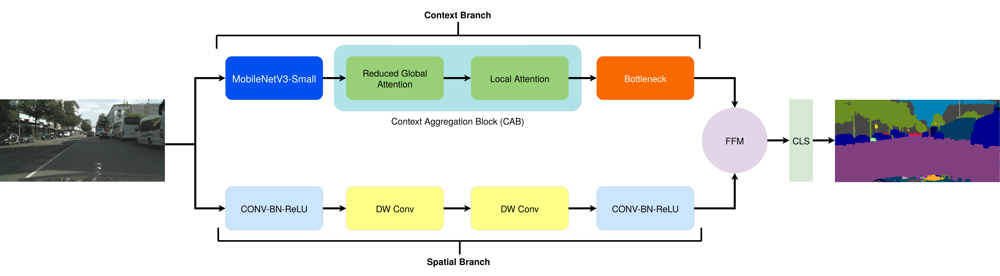
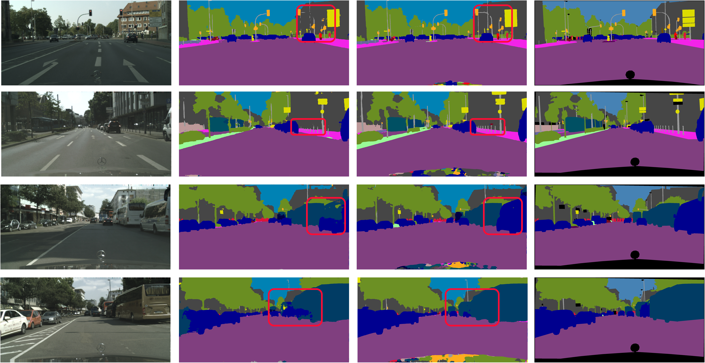
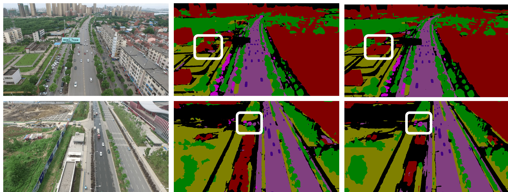

# CABiNet: Efficient Context Aggregation Network for Semantic Segmentation

[](LICENSE)
[](https://www.python.org/downloads/)
[](https://pytorch.org/)
[](https://github.com/dronefreak/CABiNet/actions/workflows/ci.yml)
[](https://github.com/astral-sh/ruff)
[](https://huggingface.co/spaces/dronefreak/uavid-aerial-segmentation)

CABiNet is a dual-branch CNN for real-time semantic segmentation — competitive accuracy at
a fraction of the compute of comparable methods, aimed at autonomous systems and aerial
imagery. This repo also benchmarks CABiNet head-to-head against Ultralytics YOLO26's dense
`semantic` task under one shared pipeline on three aerial datasets.

**Live demo:** [dronefreak/uavid-aerial-segmentation](https://huggingface.co/spaces/dronefreak/uavid-aerial-segmentation)
on Hugging Face Spaces — run any Model Zoo checkpoint on your own aerial image.

<p align="center">
  
</p>

## Architecture



- **Spatial Branch** — high-resolution features for precise boundaries
- **Context Branch** — lightweight global aggregation + local distribution over a MobileNetV3 backbone
- **Feature Fusion Module (FFM)** — normalizes and reweights the two branches
- **Deep supervision** — auxiliary head on the context branch

## Results

Comparison on the Cityscapes (left) and UAVid (right) validation sets:

<p align="center">
   
</p>

### Model Zoos

CABiNet and YOLO26-sem are trained and evaluated under one shared pipeline per dataset
(`images/` + `masks/` layout, single-channel class-ID masks). Params/FLOPs are
architecture-only (`thop` for CABiNet, Ultralytics' profiler for YOLO26; both report
FLOPs as 2×MACs, so the families are directly comparable **within a table**).

- **UAVid / VDD** — test-split mIoU, measured at 1024×1024
- **AeroScapes** — val-split mIoU (no source test split), measured at 720×720; **FLOPs not
  comparable to the other two tables**

<details open>
<summary><b>UAVid</b> — 8 classes; CABiNet beats every YOLO26 variant at far lower compute</summary>

| Model                       | mIoU (%) | Params (M) | FLOPs (G) | Weights                                                                 |
| --------------------------- | -------- | ---------- | --------- | ----------------------------------------------------------------------- |
| CABiNet (MobileNetV3-Large) | 68.60    | 9.17       | 54.8      | [HF](https://huggingface.co/dronefreak/cabinet-mobilenetv3-large-uavid) |
| CABiNet (MobileNetV3-Small) | 66.84    | 5.36       | 44.1      | [HF](https://huggingface.co/dronefreak/cabinet-mobilenetv3-small-uavid) |
| YOLO26x-sem                 | 64.41    | 40.16      | 430.9     | [HF](https://huggingface.co/dronefreak/uavid-yolo26x-sem)               |
| YOLO26l-sem                 | 63.28    | 17.87      | 192.4     | [HF](https://huggingface.co/dronefreak/uavid-yolo26l-sem)               |
| YOLO26m-sem                 | 61.98    | 14.32      | 152.3     | [HF](https://huggingface.co/dronefreak/uavid-yolo26m-sem)               |
| YOLO26s-sem                 | 61.69    | 6.50       | 44.4      | [HF](https://huggingface.co/dronefreak/uavid-yolo26s-sem)               |
| YOLO26n-sem                 | 58.17    | 1.63       | 11.4      | [HF](https://huggingface.co/dronefreak/uavid-yolo26n-sem)               |

</details>

<details>
<summary><b>VDD</b> — 7 classes, 280 train images; YOLO26x/l edge ahead by ≤1.1 pts</summary>

| Model                       | mIoU (%) | Params (M) | FLOPs (G) | Weights                                                               |
| --------------------------- | -------- | ---------- | --------- | --------------------------------------------------------------------- |
| YOLO26x-sem                 | 78.83    | 40.16      | 430.9     | [HF](https://huggingface.co/dronefreak/vdd-yolo26x-sem)               |
| YOLO26l-sem                 | 78.57    | 17.87      | 192.4     | [HF](https://huggingface.co/dronefreak/vdd-yolo26l-sem)               |
| CABiNet (MobileNetV3-Large) | 77.76    | 9.17       | 54.8      | [HF](https://huggingface.co/dronefreak/cabinet-mobilenetv3-large-vdd) |
| YOLO26m-sem                 | 77.02    | 14.32      | 152.3     | [HF](https://huggingface.co/dronefreak/vdd-yolo26m-sem)               |
| YOLO26s-sem                 | 76.35    | 6.50       | 44.4      | [HF](https://huggingface.co/dronefreak/vdd-yolo26s-sem)               |
| YOLO26n-sem                 | 73.99    | 1.63       | 11.4      | [HF](https://huggingface.co/dronefreak/vdd-yolo26n-sem)               |

</details>

<details>
<summary><b>AeroScapes</b> — 12 classes; CABiNet-Large within 0.53 pts of the top at ~7.8× less compute</summary>

| Model                       | mIoU (%) | Params (M) | FLOPs (G) | Weights                                                                      |
| --------------------------- | -------- | ---------- | --------- | ---------------------------------------------------------------------------- |
| YOLO26x-sem                 | 68.36    | 40.15      | 213.0     | [HF](https://huggingface.co/dronefreak/aeroscapes-yolo26x-sem)               |
| YOLO26l-sem                 | 68.00    | 17.86      | 95.1      | [HF](https://huggingface.co/dronefreak/aeroscapes-yolo26l-sem)               |
| CABiNet (MobileNetV3-Large) | 67.83    | 9.18       | 27.4      | [HF](https://huggingface.co/dronefreak/aeroscapes-cabinet-mobilenetv3-large) |
| YOLO26m-sem                 | 66.97    | 14.31      | 75.2      | [HF](https://huggingface.co/dronefreak/aeroscapes-yolo26m-sem)               |
| YOLO26s-sem                 | 65.44    | 6.50       | 21.9      | [HF](https://huggingface.co/dronefreak/aeroscapes-yolo26s-sem)               |
| YOLO26n-sem                 | 64.86    | 1.63       | 5.6       | [HF](https://huggingface.co/dronefreak/aeroscapes-yolo26n-sem)               |

</details>

Model cards are generated from [`hf_modelcards/`](hf_modelcards/) — run
`python hf_modelcards/generate_hf_model_zoo.py` to regenerate.

## Installation

Requires Python 3.10+ and (recommended) a CUDA GPU.

```bash
git clone https://github.com/dronefreak/CABiNet.git
cd CABiNet

conda env create -f environment.yml && conda activate cabinet
pip install -e .            # core (CABiNet)
pip install -e ".[yolo]"    # + Ultralytics, for the YOLO26 pipeline
pip install -e ".[dev]"     # + ruff / mypy / bandit / pytest / pre-commit
```

## Quickstart (UAVid, end to end)

```bash
# 1. Download UAVid from https://uavid.nl/  (Downloads section)

# 2. Convert RGB masks -> single-channel class-ID format (shared by both pipelines)
python src/scripts/convert_uavid_to_yolo.py \
    --src /data/uavid --dst /data/uavid_yolo \
    --info configs/UAVid_info.json --split both --workers 8
export UAVID_YOLO_ROOT=/data/uavid_yolo

# 3a. Train CABiNet  (batch_size=1 for val: UAVid source images are mixed-resolution)
python src/scripts/train.py dataset=uavid validation_config.batch_size=1

# 3b. Train YOLO26-sem  (default yolo26n-sem)
python src/scripts/train_yolo.py

# 4. Evaluate a checkpoint  (add split=test for the held-out split)
python src/scripts/evaluate.py checkpoint_path=experiments/.../cabinet_best.pth \
    dataset=uavid validation_config.batch_size=1

# 5. Inference + showcase mosaic
python src/scripts/infer_yolo.py --weights best.pt --source clip.mp4 --output outputs/inference
```

## Datasets

| Dataset    | Converter                       | CABiNet              | YOLO26 root config                    | Notes                                                                               |
| ---------- | ------------------------------- | -------------------- | ------------------------------------- | ----------------------------------------------------------------------------------- |
| Cityscapes | built-in loader                 | `dataset=cityscapes` | —                                     | ground-level; only dataset `visualize.py` supports                                  |
| UAVid      | `convert_uavid_to_yolo.py`      | `dataset=uavid`      | `train_yolo.yaml` (default)           | RGB→ID masks; `validation_config.batch_size=1`; has test split                      |
| AeroScapes | `convert_aeroscapes_to_yolo.py` | `dataset=aeroscapes` | `--config-name train_yolo_aeroscapes` | masks already single-channel; converter copies (redistributable); **no test split** |
| VDD        | `convert_vdd_to_yolo.py`        | `dataset=vdd`        | `--config-name train_yolo_vdd`        | masks already single-channel; ships train/val/test; small (280 train), heavy aug on |

Full conversion walkthroughs, class-ID/RGB mappings, and output layouts:
**[`docs/datasets.md`](docs/datasets.md)**.

### Common overrides

```bash
python src/scripts/train_yolo.py 'yolo/model@model=yolo26s-sem'        # swap YOLO size
python src/scripts/train.py training_config.epochs=200 training_config.batch_size=8
python src/scripts/train.py training_config.resume=true               # resume checkpoint_last.pth
python src/scripts/train_yolo.py runtime.device="0,1"                 # multi-GPU (DDP)

# CABiNet: warm-start the whole model (not just backbone) from another aerial checkpoint
python src/scripts/train.py dataset=aeroscapes \
    training_config.pretrained_ckpt_path=experiments/uavid/.../checkpoint_last.pth
```

### Key knobs

| Setting                 | Purpose                                                        |
| ----------------------- | -------------------------------------------------------------- |
| `cls_pw`                | 0 = uniform, 1 = full inverse-frequency (ENet) class weighting |
| `ema_decay` / `ema_tau` | EMA of weights; best/final checkpoints use the EMA model       |
| `patience`              | early stopping on mIoU (epochs w/o improvement); 0 = off       |
| `nbs`                   | YOLO gradient-accumulation target: `accum_steps = nbs / batch` |
| `amp`                   | mixed precision                                                |

See [`configs/train.yaml`](configs/train.yaml) / [`configs/train_yolo.yaml`](configs/train_yolo.yaml)
for the fully-commented set.

## Evaluation

`evaluate.py` runs multi-scale + flip sliding-window inference and accepts either a raw
state_dict or a full training checkpoint. `split=train` is rejected (training augmentation
would corrupt metrics).

```bash
# fast single-scale, no flip
python src/scripts/evaluate.py checkpoint_path=... \
    validation_config.eval_scales=[1.0] validation_config.flip=false
```

## Profiling

```python
from src.utils.profiler import PerformanceProfiler
from src.models.cabinet import CABiNet

profiler = PerformanceProfiler(CABiNet(n_classes=19, mode="large"))
results = profiler.run_full_benchmark(input_size=(1, 3, 512, 512), num_iterations=100)
```

`profiler` measures wall-clock timing / memory (via `torch.profiler`), **not** analytic
FLOPs — the Model Zoo Params/FLOPs come from `thop` separately.

## Repository layout

```
src/
├── models/      cabinet.py · cab.py · mobilenetv3.py · layers/ · constants.py
├── datasets/    cityscapes · uavid · aeroscapes · vdd · transform.py · registry.py
├── scripts/     train · evaluate · visualize · train_yolo · infer_yolo · convert_*_to_yolo
└── utils/       loss · optimizer · ema · early_stopping · class_weights · profiler
configs/         train*.yaml + dataset/ + model/ + yolo/  (Hydra)
hf_modelcards/   HF model-card generator (Jinja template + per-model metrics.json)
tests/           unit/ + integration/ + conftest.py
```

## Testing

```bash
pytest tests/                              # all
pytest tests/ --cov=src --cov-report=html  # with coverage
```

See [`tests/README.md`](tests/README.md).

## Development

Ruff (lint + format), mypy, bandit, pytest. Install hooks with `pre-commit install`.
Contribution guidelines: [`.github/CONTRIBUTING.md`](.github/CONTRIBUTING.md).

## Citation

```bibtex
@INPROCEEDINGS{9560977,
  author={Kumaar, Saumya and Lyu, Ye and Nex, Francesco and Yang, Michael Ying},
  booktitle={2021 IEEE International Conference on Robotics and Automation (ICRA)},
  title={CABiNet: Efficient Context Aggregation Network for Low-Latency Semantic Segmentation},
  year={2021}, pages={13517-13524}, doi={10.1109/ICRA48506.2021.9560977}
}
```

Full reference list (UAVid, ISPRS journal, YOLO26, this benchmark): [`CITATION.bib`](CITATION.bib).

## License

Apache 2.0 — see [LICENSE](LICENSE). Developed at the University of Twente, Faculty ITC.
Contact: kumaar324@gmail.com · [issues](https://github.com/dronefreak/CABiNet/issues)
